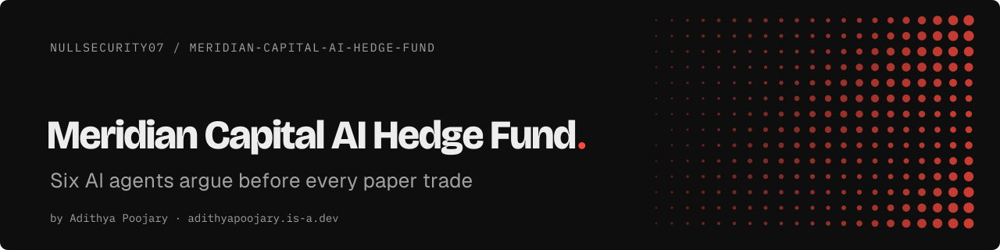
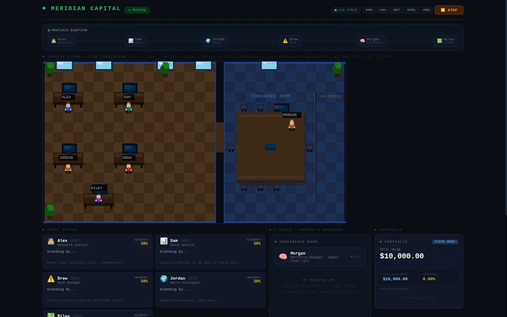
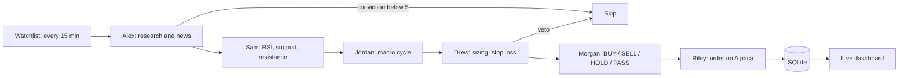

<p align="center"><a href="https://adithyapoojary.is-a.dev/work/meridian/"><picture><source media="(prefers-color-scheme: light)" srcset=".github/readme/banner-light.svg"></picture></a></p>
<p align="center"><picture><source media="(prefers-color-scheme: light)" srcset=".github/readme/badges-light.svg"></picture></p>

Meridian Capital is a paper-trading desk run by six AI agents: they research a stock, argue about it, and place the order on Alpaca while you watch every step on a live dashboard. Built for anyone who wants to see how a multi-agent system reasons, not just what it outputs.

<p align="center"></p>

## Highlights

- **Six agents, one pipeline.** A researcher, a quant, a macro strategist, a risk manager, a portfolio manager and a trader each write a report before the next one speaks.
- **Risk has a real veto.** The risk agent can block a trade and the portfolio manager cannot override it. Hard limits sit in code: 15% max per position, an 8% stop loss, and a kill switch that fires at a 5% daily loss.
- **Paper by default.** Orders go to an Alpaca paper account. A `simulation` mode keeps everything in SQLite, and real money needs both `TRADING_MODE=live` and a separate live key.
- **Free models.** Runs on the Groq free tier or a local Ollama model. No paid LLM key needed.
- **Watch it think.** A Next.js dashboard streams agent events over Server-Sent Events: who is working, what each one said, and the final call.

## How it works



1. Every 15 minutes the orchestrator picks the next symbol from the watchlist.
2. The researcher scores conviction. Low conviction ends the run early to save API calls.
3. Quant, macro and risk reports follow. A risk veto stops the trade.
4. The portfolio manager reads all four reports and decides.
5. The trader places the order, enforces a 24-hour minimum hold, and writes a lesson to agent memory when a position closes. The researcher and portfolio manager read their last five lessons on the next run.

## Quick start

Needs Node.js 20+, a free [Alpaca](https://alpaca.markets) paper account, and either a free [Groq](https://console.groq.com) key or [Ollama](https://ollama.com).

```bash
git clone https://github.com/NullSecurity07/Meridian-Capital-AI-Hedge-Fund.git
cd Meridian-Capital-AI-Hedge-Fund
npm install
cp .env.local.example .env.local   # add your Alpaca paper keys, and a Groq key or leave it empty for Ollama
npm run dev
```

Open http://localhost:5000. To use Ollama instead of Groq, leave `GROQ_API_KEY` empty and run `ollama pull qwen2.5:7b` first.

Run the tests with `npm test` (Vitest, 68 tests across 13 files).

## Project layout

```
app/            Next.js dashboard and API routes (stream, portfolio, safety, benchmarks, analyze)
lib/agents/     the six agents and the orchestrator
lib/safety.ts   kill switch and loss limits
lib/db.ts       SQLite queries (trades, positions, agent memory)
tests/          Vitest suites
```

## Status

Prototype. Built and tested against an Alpaca paper account. This is a study of multi-agent decision making, not financial advice, and it makes no claims about returns. Includes a Replit config (`.replit`, `npm run replit:start`) for running it in the cloud.

## Built by

Built by [Adithya Poojary](https://adithyapoojary.is-a.dev), founder of ThreatScope. [More projects](https://adithyapoojary.is-a.dev/work/) · [LinkedIn](https://www.linkedin.com/in/adithyapoojary/)

## License

MIT. See [LICENSE](LICENSE).
